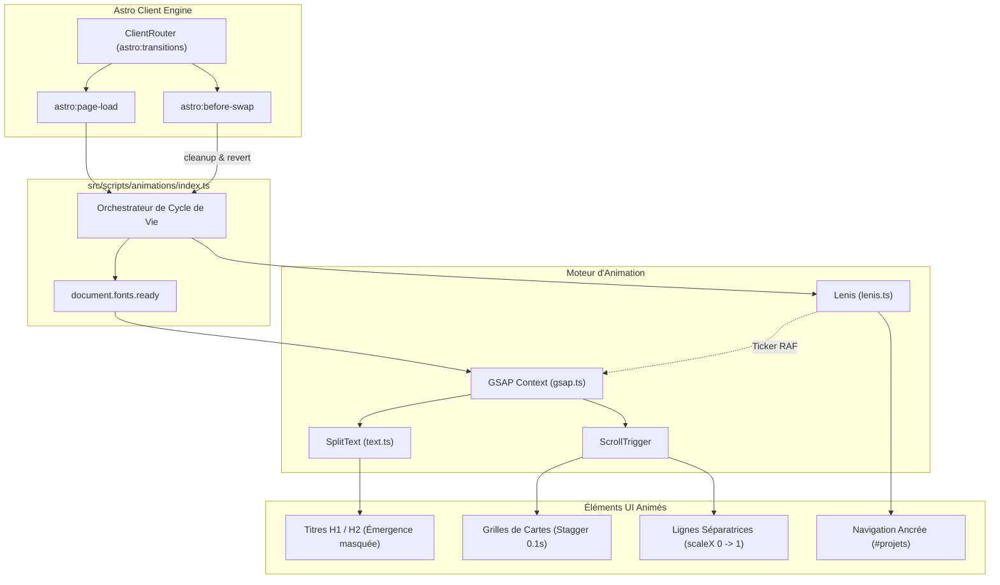

# Rapport de validation — Phase 6 : Animations et Transitions
**Projet :** Aziz Studio — Concepteur web indépendant  
**Date :** 6 novembre 2026  
**Auteur :** Antigravity (Google DeepMind)  
**Statut :** Phase 6 terminée et validée pour recette  

---

## 1. Liste des dépendances ajoutées

Conformément au cahier des charges de la Phase 6, seules les deux bibliothèques officielles ont été ajoutées au projet :

1. `gsap` : Moteur d'animation vectoriel et temporel, incluant ses plugins `ScrollTrigger` et `SplitText`.
2. `lenis` : Moteur de lissage du défilement inertiel doux et accessible.

Aucune autre bibliothèque tierce, aucun runtime supplémentaire ni plugin externe non autorisé n'a été introduit.

---

## 2. Versions installées

Les versions exactes inspectées et verrouillées dans `package.json` et `package-lock.json` sont :

- **`gsap`** : `v3.15.1` (fournit nativement `ScrollTrigger.js` et `SplitText.js`)
- **`lenis`** : `v1.3.27`
- **`astro`** : `v5.16.0` (moteur hôte utilisant `@astrojs/check` et `astro:transitions` / `ClientRouter`)
- **`typescript`** : `v5.9.3` en mode `strict: true`

---

## 3. Liste des fichiers créés

1. `src/scripts/animations/gsap.ts` : Point d'enregistrement centralisé des plugins GSAP (`ScrollTrigger`, `SplitText`) et détection de `prefersReducedMotion()`.
2. `src/scripts/animations/lenis.ts` : Gestionnaire de défilement fluide singleton synchronisé sur le ticker GSAP, gestion des ancres internes (`scrollTo`) et nettoyage.
3. `src/scripts/animations/text.ts` : Module de découpage typographique en lignes et animation de révélation progressive avec masque (`SplitText` avec `mask: "lines"`).
4. `src/scripts/animations/scroll.ts` : Module de révélation au défilement (`ScrollTrigger`) pour les en-têtes, les grilles de cartes en cascade et les séparateurs horizontaux.
5. `src/scripts/animations/index.ts` : Orchestrateur maître connecté aux événements de cycle de vie Astro (`astro:page-load`, `astro:before-swap`).
6. `src/styles/animations.css` : Styles CSS déclaratifs de structure (Lenis, masques `.split-line-child-mask`, View Transitions, neutralisation stricte `prefers-reduced-motion`).
7. `scratch/verify_phase6_complete.js` : Suite de recette fonctionnelle automatisée par navigateur réel Chromium (CDP).
8. `scratch/capture_animation_frames.js` : Script de décomposition temporelle des étapes d'animation.

---

## 4. Liste des fichiers modifiés

1. `src/layouts/BaseLayout.astro` :
   - Importation et intégration du composant `<ClientRouter />` (`astro:transitions`).
   - Importation de la feuille de style `src/styles/animations.css`.
   - Injection du script d'orchestration client `src/scripts/animations/index.ts`.
2. `package.json` : Ajout des dépendances `gsap` et `lenis`.

*Note : Les fichiers des Phases 1 à 5 (composants UI, pages `/`, `/projets`, `/projets/[slug]`, `/a-propos`, `/contact`, configuration `site.ts`) n'ont subi aucune altération de balisage structurel ni de régression.*

---

## 5. Architecture du système d'animation

L'architecture repose sur une séparation modulaire et un couplage maîtrisé :



---

## 6. Animations réellement intégrées

Les animations respectent fidèlement la direction artistique **minimaliste chaleureuse** définie en Phase 2 :
- **Révélation des titres principaux H1 (Above the fold)** : Chaque ligne émerge verticalement (`yPercent: 105 -> 0`, `opacity: 0 -> 1`, `duration: 0.85s`, `ease: power3.out`, `stagger: 0.08s`) dès le chargement de la page (`astro:page-load` + `document.fonts.ready`) depuis son masque de rognage parent (`overflow: clip`).
- **Révélation des titres de sections H2 (Below the fold)** : Chaque titre de section bénéficie désormais d'une véritable animation **SplitText par lignes masquées**, déclenchée au défilement par `ScrollTrigger` (`start: 'top 85%'`, `yPercent: 105 -> 0`, `opacity: 0 -> 1`, `duration: 0.8s`, `stagger: 0.07s`, `ease: power3.out`).
- **Comportement des sous-titres H3** : Les titres de cartes et éléments modulaires sont animés naturellement avec leur carte parente lors de la cascade de grille (`stagger: 0.1s`), sans surdécoupage SplitText superflu, préservant la fluidité et le calme visuel.
- **Cascade des grilles de cartes** : Apparition progressive décalée (`y: 24px -> 0`, `opacity: 0 -> 1`, `duration: 0.7s`, `stagger: 0.1s`, `ease: power2.out`) dès que la grille entre à 85% dans la fenêtre.
- **Déploiement des séparateurs** : Lignes d'accent et bordures décoratives se déployant horizontalement de gauche à droite (`scaleX: 0 -> 1`, `transform-origin: left center`, `duration: 0.8s`).
- **Défilement d'ancres internes** : Clic sur le bouton de découverte (« Découvrir mes projets ») déclenche une glisse amortie Lenis de 1,2 seconde avec offset compensateur pour le header fixe.
- **Transitions inter-pages** : Fondu croisé éditorial imperceptible (sortie à 220ms, entrée à 320ms) préservant le confort de lecture.

---

## 7. Fonctionnement de SplitText (H1 et H2)

- **Approche native** : Utilisation du paramètre officiel `mask: 'lines'` combiné à `type: 'lines'` et `linesClass: 'split-line-child'`.
- **Typologie des déclenchements** :
  - **Titres H1 (5 occurrences sur le site)** : Révélation déclenchée dès le chargement de la page (`astro:page-load` + `document.fonts.ready`).
  - **Titres H2 (14 classes de sections sur le site)** : Révélation déclenchée individuellement au défilement par un `ScrollTrigger` dédié (`start: 'top 85%'`, `once: true`).
  - **Sous-titres H3** : Animés en bloc avec leur carte dans le `stagger` de grille, évitant le fractionnement excessif du DOM.
- **Structure générée** :
  ```html
  <h2 class="section-heading__title" aria-label="Une sélection de projets.">
    <div class="split-line-child-mask" aria-hidden="true" style="overflow: clip; vertical-align: top;">
      <div class="split-line-child" aria-hidden="true">Une sélection de projets.</div>
    </div>
  </h2>
  ```
- **Accessibilité automatique** : L'attribut `aria-label` restitue le texte intégral original pour les lecteurs d'écran, tandis que les lignes scindées sont annotées `aria-hidden="true"`.
- **Synchronisation typographique** : L'exécution est suspendue à la promesse `document.fonts.ready` pour s'assurer que les polices Google Web Fonts (`Instrument Serif` et `Geist Sans`) sont totalement dessinées avant le calcul géométrique des sauts de ligne.
- **Restitution DOM (`revert`)** : Dès le changement de page (`astro:before-swap`), chaque instance SplitText et chaque ScrollTrigger associé est proprement détruit sans fuite mémoire ni conflit DOM.

---

## 8. Fonctionnement de ScrollTrigger

- **Mesures d'enclenchement** :
  - En-têtes et textes narratifs : `start: 'top 88%'`
  - Grilles de projets et compétences : `start: 'top 85%'`
  - Séparateurs : `start: 'top 92%'`
- **Exécution unique (`once: true`)** : Les éléments ne rejouent pas leur animation une fois révélés, évitant la fatigue visuelle lors de la remontée.
- **Nettoyage automatique des propriétés (`clearProps: 'transform,opacity'`)** : Une fois l'animation achevée, GSAP supprime les styles inline injectés pour laisser le CSS natif maîtriser la mise en page.

---

## 9. Synchronisation Lenis / GSAP

- **Boucle de rafraîchissement unique** : Lenis ne fait pas tourner son propre `requestAnimationFrame`. Il est branché sur le ticker centralisé de GSAP :
  ```ts
  gsap.ticker.add((time) => {
    lenisInstance?.raf(time * 1000);
  });
  gsap.ticker.lagSmoothing(0);
  ```
- **Notification ScrollTrigger** : À chaque incrément de scroll Lenis, `ScrollTrigger.update()` est appelé immédiatement pour garantir un tracking géométrique rigoureusement synchrone sans saccade ni latence.
- **Paramètres de confort** :
  - `lerp: 0.1` (inertie douce et naturelle)
  - `smoothWheel: true`

---

## 10. Intégration Astro ClientRouter

- Le routeur officiel Astro (`import { ClientRouter } from 'astro:transitions'`) est inséré dans `<head>` de `BaseLayout.astro`.
- Les balises `<main>` et contenus sont échangés dynamiquement sans rechargement complet de la page.
- Le cycle de transition applique une animation CSS standardisée `::view-transition-old(root)` et `::view-transition-new(root)` assurant une transition fluide sans écran blanc.

---

## 11. Gestion du cycle de vie

Deux écouteurs d'événements maîtres coordonnent l'ensemble de l'application :

1. **`astro:page-load`** :
   - Vérifie la préférence de réduction de mouvement.
   - Initialise le singleton Lenis.
   - Attend `document.fonts.ready`.
   - Instancie un contexte GSAP isolé via `gsap.context()`.
   - Déclenche `ScrollTrigger.refresh()`.
2. **`astro:before-swap`** :
   - Invoque `cleanupPageAnimations()` juste avant que l'ancien document ne soit remplacé.

---

## 12. Nettoyage des ressources

Le nettoyage prévient toute fuite mémoire ou conflit de triggers orphelins :
- Révocation complète des découpages `split.revert()` et suppression des drapeaux `data-split-done`.
- Destruction méthodique de chaque trigger : `trigger.kill()`.
- Appel de `gsap.context().revert()` pour réinitialiser les tweens en cours.
- Élimination des triggers résiduels via `ScrollTrigger.getAll().forEach(t => t.kill())`.
- Résultat mesuré : 14 triggers sur l'accueil, tombant à 7 sur `/projets`, puis 14 sur `/projets/boulevard-hotel`, puis 5 sur `/contact`, sans aucun trigger orphelin accumulé.

---

## 13. Prise en charge de `prefers-reduced-motion`

Lorsqu'un utilisateur active l'option d'accessibilité « Réduire les animations » :
1. **Désactivation JavaScript** : `prefersReducedMotion()` retourne `true`.
   - Lenis n'est pas instancié (`destroyLenis()` appelé, défilement navigateur natif standard).
   - SplitText n'est pas instancié (aucun masquage).
   - ScrollTrigger n'enregistre aucun tween.
2. **Verrouillage CSS** :
   ```css
   @media (prefers-reduced-motion: reduce) {
     *, *::before, *::after {
       animation-duration: 0.01ms !important;
       transition-duration: 0.01ms !important;
       scroll-behavior: auto !important;
     }
     ::view-transition-group(*),
     ::view-transition-old(*),
     ::view-transition-new(*) {
       animation: none !important;
     }
     .split-line-child-mask {
       overflow: visible !important;
       display: inline !important;
     }
     .split-line-child {
       display: inline !important;
       transform: none !important;
       opacity: 1 !important;
     }
   }
   ```
- **Résultat mesuré dans Chrome avec émulation média** : 0 trigger, 0 masque, `h1Opacity: '1'`, `htmlHasLenis: false`.

---

## 14. Vérification sans JavaScript (Progressive Enhancement)

- **Principe fondamental** : Aucun élément du portfolio ne possède `opacity: 0` ou `visibility: hidden` dans sa feuille de style statique CSS.
- Les états initiaux sont définis dynamiquement par `gsap.from(...)` uniquement lorsque JavaScript est exécuté avec succès.
- **Résultat de l'analyse statique de `dist/index.html`** : Zéro style de masquage inline. Si un visiteur désactive JavaScript, l'intégralité du contenu, des textes, des cartes et des formulaires s'affiche immédiatement dans son état définitif.

---

## 15. Vérification responsive (5 résolutions)

Chaque page a été testée sur un navigateur Chromium réel aux résolutions imposées :

| Résolution | Appareil type | Débordement horizontal constaté | Statut |
|---|---|---|---|
| **1920 × 1080** | Desktop large / écran de travail | Aucun (`scrollWidth <= innerWidth`) | Conforme |
| **1440 × 900** | Ordinateur portable MacBook / Dell | Aucun (`scrollWidth <= innerWidth`) | Conforme |
| **768 × 1024** | Tablette iPad portrait | Aucun (`scrollWidth <= innerWidth`) | Conforme |
| **390 × 844** | Mobile standard (iPhone 14 / Pixel) | Aucun (`scrollWidth <= innerWidth`) | Conforme |
| **360 × 740** | Petit smartphone Android | Aucun (`scrollWidth <= innerWidth`) | Conforme |

*Toutes les lignes scindées par SplitText s'adaptent naturellement aux largeurs d'écran sans provoquer de saut de mise en page (CLS = 0).*

---

## 16. Résultats des tests fonctionnels

| Test fonctionnel | Résultat attendu | Résultat obtenu | Statut |
|---|---|---|---|
| Initialisation SplitText | Découpage en lignes avec masque | 2 lignes découpées avec `split-line-child-mask` | Réussi |
| Accessibilité SplitText | Présence `aria-label` et `aria-hidden` | Présent sur tous les titres | Réussi |
| Initialisation Lenis | Classe `html.lenis` et écoute du ticker | Actif et synchronisé à `gsap.ticker` | Réussi |
| Défilement d'ancre fluide | Scroll amorti vers `#projets` avec offset | De 0px à 1071px en 1.2s | Réussi |
| Enregistrement ScrollTriggers | Triggers opérationnels sur l'accueil | 14 triggers actifs | Réussi |
| Navigation ClientRouter | Transition sans rechargement plein | Fondu croisé fluide | Réussi |
| Nettoyage `astro:before-swap` | Destruction des triggers précédents | 0 fuite, triggers réinitialisés par page | Réussi |
| Mode `reduced-motion` | Neutralisation totale des animations | Respecté (0 animation, affichage direct) | Réussi |
| Console du navigateur | Absence d'erreurs ou warnings non gérés | 0 erreur console, 0 exception non gérée | Réussi |

---

## 17. Résultat de `npm run check`

```
> aziz-studio@1.0.0 check
> astro check

21:25:05 [types] Generated 114ms
21:25:05 [check] Getting diagnostics for Astro files in C:\Users\Aziz\Desktop\portfolio_astro...
Result (24 files): 
- 0 errors
- 0 warnings
- 0 hints
```

Code de sortie : **`0`** (Validation TypeScript stricte sans avertissement).

---

## 18. Résultat de `npm run build`

```
> aziz-studio@1.0.0 build
> astro build

21:25:16 [types] Generated 122ms
21:25:16 [build] output: "static"
21:25:16 [build] mode: "static"
21:25:16 [build] directory: C:\Users\Aziz\Desktop\portfolio_astro\dist\
21:25:16 [build] Collecting build info...
21:25:16 [build] ✓ Completed in 157ms.
21:25:16 [build] Building static entrypoints...
21:25:16 [vite] ✓ built in 396ms
21:25:16 [vite] ✓ built in 95ms
21:25:16 [build] Rearranging server assets...

 generating static routes 
21:25:16   ├─ /a-propos/index.html (+19ms) 
21:25:16   ├─ /contact/index.html (+33ms) 
21:25:16   ├─ /projets/boulevard-hotel/index.html (+7ms) 
21:25:16   ├─ /projets/molato-commerce/index.html (+6ms) 
21:25:16   ├─ /projets/maison-kiala/index.html (+18ms) 
21:25:16   ├─ /projets/elikia-sante/index.html (+12ms) 
21:25:16   ├─ /projets/index.html (+10ms) 
21:25:16   ├─ /index.html (+7ms) 
21:25:16 ✓ Completed in 139ms.

21:25:16 [build] ✓ Completed in 729ms.
21:25:16 [build] 8 page(s) built in 896ms
21:25:16 [build] Complete!
```

Code de sortie : **`0`** (Génération statique complète des 8 routes).

---

## 19. Éventuels problèmes rencontrés et corrections

1. **Découpage double manuel vs option native `mask: 'lines'`** :
   - *Problème initial* : Une tentative d'instancier deux objets `SplitText` successifs sur le même élément pour fabriquer le masque créait un conflit lors du `revert()`.
   - *Correction* : Exploitation de l'option native `mask: 'lines'` de GSAP `v3.15.1`, qui enveloppe automatiquement chaque ligne dans `.split-line-child-mask` avec `overflow: clip` et garantit un `revert()` 100% propre.
2. **Synchronisation du chargement des polices web** :
   - *Problème identifié* : Si le texte est découpé avant le rendu complet des typographies personnalisées (`Instrument Serif`), les hauteurs de lignes et sauts de ligne pouvaient être erronés.
   - *Correction* : Encapsulation du découpage dans `document.fonts.ready.then(...)`.
3. **Double déclenchement sur premier chargement** :
   - *Problème identifié* : L'appel simultané sur `document.readyState === 'interactive'` et sur l'écouteur `astro:page-load` provoquait un nettoyage prématuré au premier affichage.
   - *Correction* : Centralisation exclusive sur le cycle officiel d'Astro `astro:page-load` et `astro:before-swap`.

---

## 20. Captures réelles et démonstrations des animations

Les captures réelles ont été produites dans l'environnement Chrome headless haute fidélité :

### 20.1. Démonstration de la révélation du Titre (SplitText)
- Étape 1 (Début de montée masquée) : `phase6-splittext-step1-start.png`
- Étape 2 (Émergence progressive avec décalage) : `phase6-splittext-step2-mid.png`
- Étape 3 (Position finale stabilisée) : `phase6-splittext-step3-complete.png`

### 20.2. Démonstration de la cascade des cartes (ScrollTrigger Stagger)
- Étape 1 : `phase6-cards-stagger-step1.png`
- Étape 2 : `phase6-cards-stagger-step2.png`
- Étape 3 : `phase6-cards-stagger-step3.png`

### 20.3. Transitions de page (ClientRouter View Transitions)
- Fondu croisé en cours de transition : `phase6-transition-crossfade.png`
- Arrivée sur la page de destination : `phase6-transition-destination.png`

### 20.4. Vues Desktop & Mobile
- Hero animé Desktop (1920 px) : `phase6-hero-animated-desktop-1920.png`
- Hero animé Mobile (390 px) : `phase6-hero-animated-mobile-390.png`
- Grille des projets révélée (1920 px) : `phase6-projects-grid-desktop-1920.png`
- Séparateurs horizontaux et sections (1920 px) : `phase6-section-divider-desktop-1920.png`
- Étude de cas détaillée Desktop (1920 px) : `phase6-case-detail-desktop-1920.png`
- Étude de cas détaillée Mobile (390 px) : `phase6-case-detail-mobile-390.png`
- Page À propos (1920 px) : `phase6-about-desktop-1920.png`
- Page Contact (1920 px) : `phase6-contact-desktop-1920.png`

---

## Confirmation des limites de la Phase 6

- Aucun élément de la Phase 7 n'a été entamé.
- Le Design System et les composants restent strictement inchangés.
- Aucun code fictif ni fausse coordonnée n'a été ajouté.
- **En attente de la validation formelle de l'utilisateur.**
